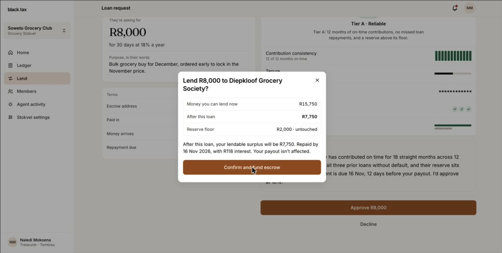

# black.tax

**An agent that runs a stokvel's treasury, explains every decision it makes, and settles loans between stokvels in USDC on Arc.**

Built for the [Tameion Agents Hackathon](https://tameion.thecanteenapp.com) (Canteen × Circle, 27 Sep – 17 Oct 2026). Closest fit: **RFB 4, Autonomous Business Operator**, with angles on RFB 1 (treasury) and RFB 3 (escrow).

> **On-chain proof:** the loan approved in the demo video settled through Circle's ERC-8183 escrow on Arc Testnet as **[job 186930](#on-chain-proof-arc-testnet)**, six transactions, all successful.

## Demo video (3 min)

[](docs/recording/black.tax-demo.mp4)

▶ **[Watch the demo](docs/recording/black.tax-demo.mp4)** (MP4, 3:06). It shows:

1. **Sign-in:** a treasurer signs in with a phone number and a one-time code.
2. **Home:** the Debt-Payoff stokvel, where every figure traces to a Beancount ledger entry and its file hash.
3. **Pause:** a member's bank cancels her DebiCheck mandate. The agent pauses the next payout and explains why.
4. **Loan:** the agent grades another stokvel's loan request as Tier A. The treasurer approves it, and six real transactions settle it on Arc Testnet.
5. **Proof:** the transaction on the Arc explorer, then the LOAN_OUT ledger entry that carries its hash.

## Contents

- [Why](#why)
- [What it does](#what-it-does)
- [How the agent decides](#how-the-agent-decides)
- [On-chain proof (Arc Testnet)](#on-chain-proof-arc-testnet)
- [Architecture](#architecture)
- [Run it](#run-it)
- [Testing](#testing)
- [Security](#security)
- [What is real, what is mocked](#what-is-real-what-is-mocked)
- [Roadmap and production notes](#roadmap-and-production-notes)

## Why

About 11 million South Africans save together in roughly 800,000 stokvels, which move around R50 billion a year (NASASA estimates). Meanwhile 10.5 million credit-active South Africans, 36% of them, have impaired credit records (NCR, June 2025), and unsecured credit can legally cost repo + 21% a year.

Stokvels are already trusted, disciplined pools of money. Yet most are run by a volunteer treasurer with a notebook and a WhatsApp group: chasing late contributions, deciding who gets paid, and keeping books nobody can check.

black.tax gives that treasurer an agent that does the routine work, refuses to break the group's own rules, and writes down why it did everything.

## What it does

### Debt-Payoff stokvels
Members pool their contributions to clear the group's most expensive debt first, an "avalanche" run as a group:
- **Payouts:** the agent pays the highest-interest debt in the queue with whatever sits above the reserve floor.
- **Recycling:** when a member is debt-free, their freed-up minimum payment is recycled into the pool, so the plan speeds up.
- **Pauses:** if a mandate is cancelled or a contribution is overdue, the agent pauses payouts, says who and why, and resumes when it's fixed.

### Lending between stokvels
A stokvel with idle cash can lend to another one:
- **How much:** the agent works out how much can be lent safely, keeping the reserve floor and upcoming commitments (such as a bulk-buy deposit) locked.
- **Grading:** each request gets Tier A, B or C, with plain-language reasons and a recommendation.
- **Settlement:** once the treasurer approves, the agent funds and releases the loan through an ERC-8183 escrow in USDC on Arc.

### A ledger nobody can quietly edit
- **Append-only:** every rand that moves is appended to a Beancount double-entry file, one per stokvel.
- **Hashed:** each write returns the file's SHA-256, which is stored with the entry.
- **Linked:** each business record links to the agent decision that caused it and, for loans, to the Arc transaction.

### Two roles
- **Treasurer:** runs the agent, approves loans, changes the constitution (every change is logged), exports the ledger.
- **Member:** sees their own debt, queue position and the group's ledger, but can't change anything.

## How the agent decides

The agent is policy-bound. It applies rules from the stokvel's constitution through a pure function, `decide()` in [`backend/agent/src/decide.ts`](backend/agent/src/decide.ts). It holds no state between runs, and every decision is recorded in three parts: *What I saw*, *What I decided*, *What happened*.

| Situation | What the agent does |
|---|---|
| A member's DebiCheck mandate is cancelled, or a contribution is more than two days overdue | **Pauses** payouts, naming the member, the amount held and the days overdue, and notifies them |
| The pool falls below the reserve floor | **Pauses** payouts. The reserve is never paid out. |
| The reason for a pause is resolved | **Resumes** and records why |
| There is money above the reserve | **Pays** the highest-interest open debt `min(pool − reserve, balance)`; when a debt clears, notes the recycled minimum |
| The constitution requires approval | **Proposes** the payment instead of making it |
| Another stokvel asks to borrow | **Assesses** it (Tier A, B or C) on contribution record, tenure, repayments and reserve, and recommends approve or decline |
| The treasurer approves a loan | **Settles** it on Arc: `createJob → setBudget → approve → fund → submit → complete`, each step confirmed before the next |

**Humans stay in control:**
- **Loans:** always need the treasurer's approval.
- **Payouts:** follow the constitution's fixed rules. A stokvel can switch the agent to approval mode, so it proposes instead of paying.
- **Overrides:** a treasurer can resume through a pause, and the override is logged.
- **No discretion over money:** no free-form model judgment releases money, in line with Canteen's *Agents and Ledgers* essay.

**Safe to retry:**
- **Ledger writes:** each carries an `entry_id` derived from the state the decision was made on, so a retry can't pay twice.
- **Arc steps:** each Circle call carries an idempotency key derived from the loan and the step.
- **Concurrency:** the agent runs one operation per stokvel at a time.

## On-chain proof (Arc Testnet)

In the demo video, the treasurer of Soweto Grocery Club approves a R8,000, 30-day loan at 18% to Diepkloof Grocery Society (`REQ-31`). With `ARC_DEMO_SCALE=0.001` it settles as **0.444444 USDC** through Circle's ERC-8183 *Agentic Commerce* contract [`0x0747EEf0706327138c69792bF28Cd525089e4583`](https://explorer.testnet.arc.io/address/0x0747EEf0706327138c69792bF28Cd525089e4583).

**Job 186930**, 18 Oct 2026 at 03:02 SAST. All six transactions succeeded:

| # | Step | Signed by | Transaction |
|---|---|---|---|
| 1 | `createJob` | lender | [0x76bac3f2…82260e](https://explorer.testnet.arc.io/tx/0x76bac3f2bfed29296e400c42bf84b50d1ac7c28150949282b304ba625482260e) |
| 2 | `setBudget` | borrower | [0x9c674086…ac2001e](https://explorer.testnet.arc.io/tx/0x9c6740869c65d8def85089f7d45c566d0be01c99afe37c663665a5443ac2001e) |
| 3 | `approve` (USDC) | lender | [0xf0e555c6…49cdb91b](https://explorer.testnet.arc.io/tx/0xf0e555c6e414f30a1bee1200103ecf317df742f48b8d395016cd92b849cdb91b) |
| 4 | `fund` | lender | [0xce4584bc…b2991ec1](https://explorer.testnet.arc.io/tx/0xce4584bc2ea9dd80f079c1d4e874b28f48a6b7c53a048a69e662da78b2991ec1) |
| 5 | `submit` | borrower | [0x487258f2…8ac91399](https://explorer.testnet.arc.io/tx/0x487258f2417fb6ecbfef523ee996714d74befbe88f52bdf3cfa644488ac91399) |
| 6 | `complete` (releases USDC) | lender | [0x622cd479…258bfb10](https://explorer.testnet.arc.io/tx/0x622cd4793b00a3314995a79fa4283f0bf9cf36f8e4fbe2c8f0ac129f258bfb10) |

- **Wallets:** the lender wallet [`0x6a0646ea…5dc8`](https://explorer.testnet.arc.io/address/0x6a0646ea5e95e264b459ae0b25db6d494a1e5dc8) is the job's client and evaluator. The borrower wallet [`0x420041a5…c891`](https://explorer.testnet.arc.io/address/0x420041a5f9366f8653c3599b5c885ca29daac891) is its provider. Both are Circle developer-controlled wallets on `ARC-TESTNET`.
- **In the app:** Agent activity shows decision G-04 with every hash, and the ledger's LOAN_OUT entry carries the final one.
- **Earlier run:** the same flow first settled as [job 186928](docs/arc-testnet.md#proof) on 17 Oct 2026.

How the contract is used, and how to reproduce this with your own Circle account: [docs/arc-testnet.md](docs/arc-testnet.md).

## Architecture

```
                         ┌──────────────────────────── Arc Testnet ───────────────────────────┐
                         │  USDC · ERC-8183 escrow · Circle developer-controlled wallets      │
                         └────────────────────────────────▲───────────────────────────────────┘
                                                          │ createJob … complete
 frontend ──JWT──▶ core (system of record) ──service──▶ agent (decide · assess · settle)
 Next.js          Spring Boot · Postgres     token        │   ▲
                    ▲   │   ▲                             │   └── reads state, writes decisions
 Stitch ──signed────┘   │   └──── internal API ───────────┘
 (webhooks)             ▼
                  ledger (FastAPI · Beancount; append-only, returns the file hash)
```

| Service | Stack | Responsibility |
|---|---|---|
| [`frontend/`](frontend/README.md) | Next.js, TypeScript | Treasurer and member screens built from the Claude Design handoff; typed client generated from `api/core.yaml` |
| [`backend/core/`](backend/core/README.md) | Spring Boot 4 on JHipster 9, Postgres, Liquibase | System of record. Phone-OTP JWT sign-in, per-stokvel tenancy, Stitch webhooks, daily collection and agent jobs, ledger mirror |
| [`backend/agent/`](backend/agent/README.md) | Node 22, TypeScript | Decision engine, credit assessment, ERC-8183 escrow through the Circle SDK. Stateless. |
| [`backend/ledger/`](backend/ledger/README.md) | Python 3.11, FastAPI, Beancount 3 | Append-only ledger, one file per stokvel; validates the whole file before each write and returns its hash |
| Postgres 17 | Docker | Core's database |

### API-first
The contracts in [`api/`](api) are the source of truth.
- **Core:** its Java interfaces and DTOs are generated from `core.yaml` by openapi-generator (delegate pattern), and the hand-written code lives in the delegates.
- **Agent and frontend:** their TypeScript types are generated with openapi-typescript.
- **Consequence:** change a contract, regenerate, and the compiler shows everything that no longer matches.

| Contract | Consumers |
|---|---|
| [`api/core.yaml`](api/core.yaml) | frontend → core; agent → core (internal endpoints) |
| [`api/agent.yaml`](api/agent.yaml) | core → agent |
| [`api/ledger.yaml`](api/ledger.yaml) | core, agent → ledger |

### How a loan flows
1. **Request:** another stokvel's request arrives at core, which asks the agent to assess it. The tier and reasons are stored with the request.
2. **Claim:** the treasurer approves, and core claims the request atomically (`OPEN → APPROVED`), so a double click or a second treasurer can't fund it twice.
3. **Settle:** the agent converts rand to USDC and runs the six ERC-8183 steps through Circle, waiting for each one to confirm. It reads the job ID from the `JobCreated` event.
4. **Record:** the agent appends a LOAN_OUT entry (the Arc hash in its metadata) to the ledger and writes the decision, with every hash, back to core.
5. **Recover:** if any step fails, core reverts the claim and the treasurer sees why.

### Per-stokvel isolation
- **Tenant column:** every tenant-owned row carries the stokvel ID, and Hibernate's `@TenantId` filters every query.
- **Membership check:** an interceptor checks that the caller belongs to the stokvel in the path.
- **Test:** `TenantIsolationIT` asserts this on every read endpoint.

### Repository layout
```
api/                OpenAPI contracts (+ Schemathesis config)
backend/core/       Spring Boot (JHipster) system of record
backend/agent/      decision engine and Arc rail
backend/ledger/     Beancount ledger service
frontend/           Next.js app
design/             the Claude Design prototype the screens were built from
docs/               demo guide, Arc setup, testing, demo recording
scripts/stack.sh    start | stop | restart [--build] | status | reset
scripts/demo.sh     drive demo scenarios (pause, resume, fail, run, balances)
```

## Run it

**Requirements:**
- **Always:** Docker Desktop.
- **Only to run services outside Docker:** Node 22+, Java 21 and Python 3.11.

```bash
cp .env.example .env            # set SERVICE_TOKEN and STITCH_WEBHOOK_SECRET at least
./scripts/stack.sh start --build
```

Open http://localhost:3000 and sign in:

| Person | Phone | Code | Role |
|---|---|---|---|
| Naledi Mokoena | 082 555 0147 | `123456` | Treasurer of Masakhane Debt Freedom and Soweto Grocery Club |
| Bongani Zulu | 061 330 7742 | `123456` | Member of Masakhane (read-only) |

The fixed code only works under core's `dev` profile, which is the compose default.

### Stack control
```bash
./scripts/stack.sh status       # containers, health, URLs
./scripts/stack.sh restart      # stop everything (Docker and native dev processes) and start again
./scripts/stack.sh stop
./scripts/stack.sh reset        # wipe and reseed the demo data (asks first)
```

### Demo scenarios
```bash
./scripts/demo.sh pause         # Lerato's bank cancels her mandate; the agent pauses the payout
./scripts/demo.sh resume        # she re-approves; the agent resumes
./scripts/demo.sh fail          # Thabo's collection fails
./scripts/demo.sh run           # run the Masakhane agent now
./scripts/demo.sh balances      # Arc wallet balances
```

[docs/demo.md](docs/demo.md) has the seeded stokvels and loan requests, every scenario with its expected result, and the video walkthrough. Setting `NEXT_PUBLIC_DEMO=true` shows an in-app demo bar that runs the same scenarios.

### Settling on Arc for real
Without Circle credentials the agent uses a mock rail. It runs the same steps and returns the same shapes, and every decision and ledger entry it produces is labelled "mock". To settle on Arc Testnet, set these in `.env`:
- `CIRCLE_API_KEY` and `CIRCLE_ENTITY_SECRET`;
- the two wallets, `ARC_LENDER_*` and `ARC_BORROWER_*`;
- `ARC_MODE=circle`.

The scripts in `backend/agent/scripts/` register the entity secret, create the wallets and show their balances. Step by step: [docs/arc-testnet.md](docs/arc-testnet.md).

### Main settings (`.env`)

| Variable | Purpose |
|---|---|
| `SERVICE_TOKEN` | Shared secret between core, agent and ledger |
| `STITCH_WEBHOOK_SECRET` | Verifies Stitch webhook signatures |
| `DB_PASSWORD`, `JWT_BASE64_SECRET` | Database password; core's JWT signing key (required outside the dev profile) |
| `ARC_MODE` | `circle` for Arc Testnet, otherwise mock |
| `ZAR_PER_USDC`, `ARC_DEMO_SCALE` | Rand → USDC conversion; the scale keeps rand-sized loans within faucet balances |
| `ARC_AUTO_DISBURSE` | `false` stops after `fund` and leaves the release for later |
| `ARC_RUN_ID` | Scopes Circle idempotency keys. `stack.sh reset` sets a new one, so reseeded requests open new jobs. |
| `NEXT_PUBLIC_DEMO` | Shows the in-app demo bar |

The full list, with defaults, is in [`.env.example`](.env.example).

## Testing

| Part | Command | Covers |
|---|---|---|
| core | `cd backend/core && ./mvnw verify -Dit.test=TenantIsolationIT` | Tenant isolation on every read endpoint, roles, service token (Testcontainers Postgres) |
| agent | `npm test -w backend/agent` | Decision loop, credit tiers, Arc call sequence, signers and idempotency, input validation (21 tests) |
| ledger | `cd backend/ledger && .venv/bin/python -m pytest` | Hashing, balancing, service token, injection attempts, idempotency, bounds (8 tests) |
| frontend | `npm run smoke -w frontend` | Every screen, sheet and breakpoint rendered from live API data, for a treasurer and a member |
| contracts | [Schemathesis](https://schemathesis.readthedocs.io) against all three OpenAPI specs | 2,101 core, 241 agent and 293 ledger generated cases, all passing |

The agent's Docker image runs its tests during the build. Commands and notes: [docs/testing.md](docs/testing.md).

## Security

- **Sign-in:**
  - Phone + one-time code.
  - Codes are compared in constant time, attempts are counted atomically, and requests are rate-limited.
  - JHipster's password, registration and user-listing endpoints are switched off.
- **Demo shortcuts:** the fixed code, `/api/dev/*` and seed data exist only under the `dev` Spring profile. Outside it, core refuses to start with default secrets.
- **Service-to-service calls:**
  - The ledger and agent require a service token and validate every input before anything runs.
  - Compose exposes only the frontend and core; the ledger, agent and Postgres listen on localhost only.
- **Webhooks:** Stitch events are HMAC-verified over the raw body, and each event is processed only once.
- **Money movement:**
  - A loan request is claimed atomically before any money moves.
  - Ledger amounts are pinned to ZAR with 2 decimals, and account names are pattern-checked.
  - Ledger query errors are not leaked.
- **Circle secrets:**
  - The entity secret lives only in `.env`, and its recovery file is kept outside the repository.
  - No personal data goes on chain: job descriptions are opaque references, and deliverables are hashes.

## What is real, what is mocked

| Part | Status |
|---|---|
| Arc escrow (USDC, ERC-8183) | **Live on Arc Testnet** with `ARC_MODE=circle` (see the proof above). Without credentials a mock rail is used, labelled "mock" wherever it appears. |
| Agent decisions, credit assessment | Real, running in the stack |
| Beancount ledger, hashes, CSV export | Real |
| Tenancy, auth, roles | Real (SMS delivery is logged; plug a provider into `AuthDelegate.requestOtp`) |
| Stitch DebiCheck | **Mock rail.** It sends correctly signed webhooks to core, so the webhook → agent → ledger path runs end to end. The real Stitch API differs (see the roadmap). |
| Stokvels and members | Seeded demo data; no real stokvels onboarded yet |

## Roadmap and production notes

1. **Live Stitch integration:**
   - mandates through `paymentConsentRequestCreate`;
   - collections as SFTP batch files;
   - Svix-signed webhooks.
2. **Repayment on chain:** ERC-8183 is a pay-for-work escrow with no repayment primitive. Repayment would be a USDC transfer back, or a second job with the roles reversed.
3. **Keys per stokvel:**
   - **Now:** the agent signs for both wallets, which makes the escrow custodial in substance.
   - **In production:** each stokvel holds its own keys, and the USDC leg runs behind a licensed crypto-asset service provider.
4. **Regulation:** interest-bearing loans between stokvels likely require credit-provider registration in South Africa. The rand products (debt payoff and savings) can launch first. These notes are not legal opinions; they need South African counsel.
5. **Real users:** onboard pilot stokvels, add SMS and WhatsApp delivery, and add a member-facing mobile layout tuned on real usage.

## Built for Tameion

Everything here was built for the hackathon, before the submission deadline of 17 Oct 2026, 11:59 PM ET:
- the screens, from a Claude Design prototype in [`design/`](design);
- the API contracts;
- the four services;
- the tests;
- the Arc integration.

The commit history and the on-chain transactions above carry their timestamps.
